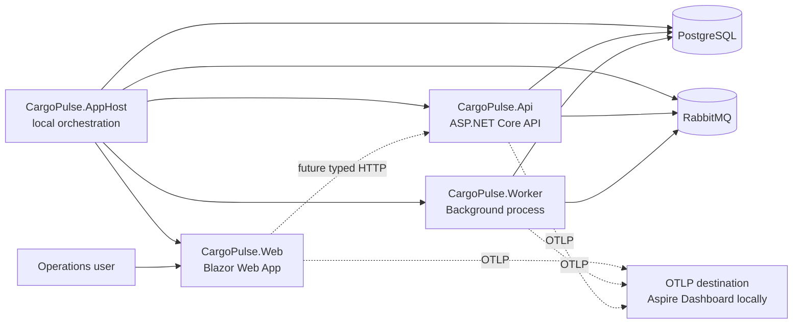

# CargoPulse

[](https://github.com/DizzyZ7/CargoPulse/actions/workflows/ci.yml)
[](https://github.com/DizzyZ7/CargoPulse/actions/workflows/codeql.yml)

CargoPulse is a Shipment Exception Control Tower for logistics operations. It is being built as a production-oriented modular monolith with a separate background worker, PostgreSQL as the planned source of truth, and RabbitMQ for reliable at-least-once message delivery.

> **Current status:** Milestone 0 (Foundation) is implemented. This repository does not yet contain shipment, carrier, tracking, SLA, exception, notification, identity, or reporting workflows.

## Problem and business value

Carriers report shipment events in incompatible formats and may deliver them late, out of order, or more than once. Operations teams need one trustworthy timeline, explainable SLA risk, controlled exception ownership, notification evidence, and an auditable history of decisions.

CargoPulse will provide that operational view without claiming exactly-once delivery or hiding deterministic SLA decisions behind opaque AI.

## Milestone 0 status

| Capability | Status |
|---|---|
| .NET 10 solution and centralized package management | Implemented |
| API, worker, Blazor Web, AppHost, and ServiceDefaults | Implemented |
| Aspire orchestration for PostgreSQL and RabbitMQ | Implemented |
| Docker Compose infrastructure alternative | Implemented |
| Liveness and readiness endpoints | Implemented |
| Worker heartbeat | Implemented |
| Serilog compact JSON logs and correlation IDs | Implemented |
| OpenTelemetry traces and metrics through OTLP | Implemented |
| In-process foundation smoke tests | Implemented |
| Locked dependencies, vulnerability audit, CI, CodeQL, container builds | Implemented |
| Domain modules, EF Core model, migrations, and business APIs | Deferred to Milestone 1+ |
| JWT/RBAC, HMAC webhook ingestion, outbox/inbox, and SignalR | Deferred |
| Prometheus, Grafana, Tempo deployment and production dashboards | Deferred to Milestone 6 |

Local verification on 2026-08-03 completed with a successful locked restore, Release build with zero warnings, and seven passing smoke tests.

## Architecture



The AppHost is a local development and test orchestrator, not a production deployment unit. Domain modules and building blocks are intentionally not scaffolded as empty projects; they will be added when Milestone 1 introduces real domain code and dependency rules.

See [the architecture overview](docs/architecture/overview.md) and [ADR-0001](docs/adr/0001-modular-monolith-process-boundaries.md).

## Repository layout

```text
CargoPulse.sln
src/
  CargoPulse.Api/              HTTP API composition root
  CargoPulse.Worker/           background host and heartbeat
  CargoPulse.Web/              Blazor operator shell
  CargoPulse.AppHost/          Aspire local orchestrator
  CargoPulse.ServiceDefaults/  logging, telemetry, resilience, probes
tests/
  CargoPulse.IntegrationTests/ in-process foundation smoke tests
docs/
  architecture/                current architecture documentation
  adr/                         architectural decisions
  runbooks/                    operational procedures
```

## Technology baseline

- .NET 10 / C# 14 / ASP.NET Core / Blazor
- .NET Aspire 13.4.6
- PostgreSQL 18.4 and RabbitMQ 4.3.4
- OpenTelemetry over OTLP and Serilog compact JSON
- xUnit v3 and FluentAssertions
- Docker, Docker Compose, GitHub Actions, and CodeQL

EF Core, Testcontainers, WireMock.Net, Prometheus, Grafana, Tempo, and SignalR remain part of the target stack and are introduced when their milestone has a real use case. Npgsql and RabbitMQ clients are already wired by the Aspire client integrations.

## Prerequisites

- .NET SDK `10.0.302` or a newer `10.0.3xx` patch allowed by `global.json`
- Docker Desktop or another compatible Linux container engine
- PowerShell 7+ for the Windows examples

The legacy .NET Aspire workload is not required. Aspire 13 is package-based and the AppHost can be started with `dotnet run`.

## Quick start with Aspire

Ensure the Docker engine is running, then:

```powershell
dotnet restore CargoPulse.sln --locked-mode
dotnet run --project src/CargoPulse.AppHost
```

Aspire starts PostgreSQL, RabbitMQ, the API, worker, Web host, and its local telemetry dashboard. Use the URLs printed by AppHost rather than assuming fixed application ports.

## Docker Compose infrastructure mode

Compose is an alternative way to run only PostgreSQL and RabbitMQ. Do not run it at the same time as AppHost unless ports and resource names are deliberately changed.

```powershell
Copy-Item .env.example .env
[Convert]::ToHexString([Security.Cryptography.RandomNumberGenerator]::GetBytes(32)).ToLowerInvariant()
```

Put separate generated values into `POSTGRES_PASSWORD` and `RABBITMQ_PASSWORD`, then run:

```powershell
docker compose config --quiet
docker compose up -d --wait
docker compose ps
```

The application Dockerfiles are built in CI and run as non-root users. A full application deployment Compose profile is intentionally deferred until the database model and startup migration strategy exist.

Detailed setup and troubleshooting are in the [local development runbook](docs/runbooks/local-development.md).

## Current endpoints

| Host | Endpoint | Purpose |
|---|---|---|
| API | `GET /` | Foundation service metadata |
| API | `GET /openapi/v1.json` | OpenAPI document in Development |
| API, Worker, Web | `GET /health` | Process-only liveness |
| API, Worker, Web | `GET /ready` | Readiness including registered dependencies |
| Web | `GET /` | Honest Milestone 0 operator shell |

`/health` deliberately ignores PostgreSQL and RabbitMQ to avoid restart loops. `/ready` includes all registered dependency checks and can return `503` when the instance should not receive work. API and worker always fail at startup when either required connection string is absent. The isolated test factories inject non-routable placeholders and remove only external dependency checks after host composition. Probe responses never expose exception details or connection strings. A production ingress must expose probes only to its management network.

## Observability

- Every HTTP response carries a validated or generated `X-Correlation-ID`.
- W3C trace context propagates through instrumented HTTP clients.
- Logs are structured compact JSON on standard output and include correlation and trace context.
- ASP.NET Core, HttpClient, runtime, and worker heartbeat metrics are emitted through OpenTelemetry.
- OTLP export is enabled only when `OTEL_EXPORTER_OTLP_ENDPOINT` is configured; Aspire injects it locally.
- Request bodies, raw carrier payloads, tokens, cookies, and connection strings are not logged.

Prometheus, Grafana, and Tempo deployment configuration belongs to the production-evidence milestone. No fake dashboards or performance figures are included now.

## Build and test

```powershell
dotnet restore CargoPulse.sln --locked-mode
dotnet format CargoPulse.sln --verify-no-changes --no-restore
dotnet build CargoPulse.sln --configuration Release --no-restore
dotnet test CargoPulse.sln --configuration Release --no-build -- --minimum-expected-tests 7
```

The tests start API, worker, and Web hosts in process. They verify host startup, liveness/readiness, the worker heartbeat, Blazor rendering, safe correlation-ID handling, Problem Details, and security headers. Container-based PostgreSQL/RabbitMQ tests are added with the persistence and messaging milestones rather than as empty fixtures.

Package lock files cover every runtime and test project. AppHost is the deliberate exception because Aspire selects orchestration packages for the current SDK host RID (`win-x64`, `linux-x64`, or macOS); a single AppHost lock file is not portable. Exact direct package versions and transitive vulnerability auditing still apply to AppHost.

CI also validates Compose, audits direct and transitive NuGet dependencies, builds all three runtime containers, verifies a non-root runtime user, and runs CodeQL. Failed test results are retained as artifacts for seven days.

## Demo credentials and scenario

Application authentication is not implemented in Milestone 0, so there are no demo user credentials. PostgreSQL and RabbitMQ credentials are generated locally and must never be committed.

The current demo scenario is a foundation smoke run: AppHost starts all resources, dependency readiness becomes healthy, the Blazor shell loads, and traces/logs are visible in the Aspire dashboard. Shipment exception scenarios begin after the domain model exists.

## Security posture

Implemented now:

- fail-fast local infrastructure secrets with no committed defaults;
- restricted CORS by default, immediate-peer-partitioned rate limiting for non-preflight application requests, and a 1 MiB API body limit;
- sanitized Problem Details and health responses;
- correlation-ID validation and safe structured logging;
- non-root chiseled application containers;
- locked packages, transitive vulnerability auditing, Dependabot, and CodeQL;
- common browser security headers.

JWT/RBAC, integration-client permissions, secure carrier-secret storage, webhook HMAC/timestamp/replay validation, and domain audit records are not claimed before their implementing milestones. See [SECURITY.md](SECURITY.md).

## MVP limitations

- No shipment or carrier persistence yet.
- No authentication or authorization yet.
- No event ingestion, state machine, SLA evaluation, exception workflow, outbox, inbox, or notifications.
- No external carrier integration or demo event generator.
- No production deployment manifest, backup automation, SLO, benchmark, or traffic claim.
- The Web host is a foundation shell, not the final operator dashboard.

## Roadmap

1. **Milestone 1:** carriers, shipments, PostgreSQL migrations, state machine, unit tests.
2. **Milestone 2:** signed tracking ingestion, normalization, idempotency, duplicates, late events.
3. **Milestone 3:** transactional outbox/inbox, RabbitMQ consumers, retries, dead letters.
4. **Milestone 4:** explainable SLA rules, exception cases, assignments, resolution, audit.
5. **Milestone 5:** complete Blazor control tower and SignalR refresh notifications.
6. **Milestone 6:** Testcontainers E2E evidence, Prometheus/Grafana/Tempo, failure drills, diagrams, and runbooks.

Screenshots will be added only after the operator UI exists.
