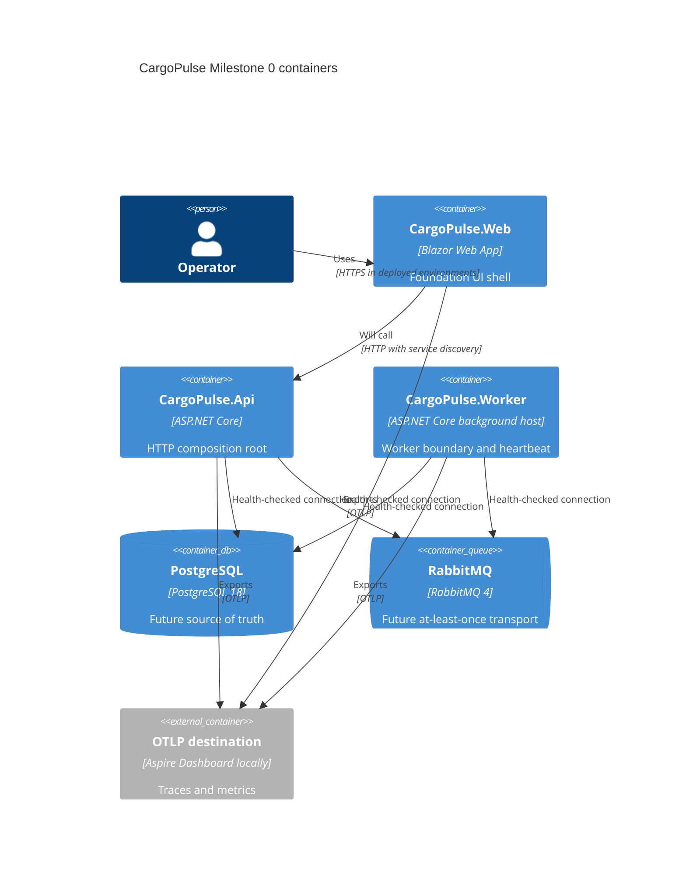

# CargoPulse architecture overview

## Scope of this document

This document describes the implemented Milestone 0 foundation. It distinguishes executable evidence from target architecture so that future capabilities are not presented as complete.

## Architectural style

CargoPulse is a modular monolith with a separate worker process:

- `CargoPulse.Api` is the HTTP composition root.
- `CargoPulse.Worker` owns scheduled and asynchronous execution boundaries.
- `CargoPulse.Web` is the Blazor operator host and does not reference the API assembly.
- `CargoPulse.AppHost` orchestrates local processes and containers through Aspire.
- `CargoPulse.ServiceDefaults` contains only cross-cutting host concerns that all executables actually use.

Domain modules are not present in Milestone 0. When implemented, they will be compiled boundaries under `Modules/` and will not reference executable hosts. Shared domain/application/infrastructure contracts will be introduced only when concrete code needs them.

## Current containers and processes



The PostgreSQL and RabbitMQ clients are always mandatory in API and worker composition. Both processes fail at startup if either connection string is absent. Isolated test factories inject non-routable placeholders and remove external dependency checks after composition. No business data access or messages exist yet.

## Dependency direction

```text
CargoPulse.Api    ─┐
CargoPulse.Worker ├──> CargoPulse.ServiceDefaults
CargoPulse.Web    ─┘

CargoPulse.AppHost ──> executable projects (Aspire resource metadata only)
IntegrationTests  ──> CargoPulse.Api
```

`CargoPulse.Web` has no project reference to `CargoPulse.Api`. AppHost is never referenced by application code.

## Reliability baseline

- PostgreSQL is reserved as the source of truth; SQLite is not used.
- RabbitMQ is the required broker; no in-memory queue is substituted.
- The intended delivery model is at-least-once. Idempotency, inbox, and transactional outbox arrive with the messaging milestone.
- UTC is the required internal time basis. The heartbeat uses `TimeProvider.GetUtcNow()`.
- Package lock files and a transitive NuGet vulnerability audit protect reproducibility. AppHost is the deliberate exception to locking because Aspire selects host-RID-specific orchestration packages; all deployable and test projects remain locked.
- Warnings and recommended analyzers fail the build.

## Health model

| Endpoint | Predicate | Intended use |
|---|---|---|
| `/health` | checks tagged `live` | process liveness; independent of external services |
| `/ready` | every registered check | traffic/work readiness; includes PostgreSQL, RabbitMQ, and worker heartbeat |

Responses expose only status, duration, and check name. They do not serialize exceptions, descriptions, data dictionaries, secrets, or connection strings.

Production deployment must keep these anonymous probe endpoints on a management network. They bypass the application request quota so dependency checks cannot be starved by user traffic.

## Logging, correlation, and tracing

The first valid `X-Correlation-ID` of at most 64 ASCII letters, digits, dots, underscores, or hyphens is preserved. Other values are replaced with the current W3C trace ID or a random identifier. The ID is returned to the caller and added to the Serilog log context and current activity tag.

Serilog writes compact JSON to standard output. OpenTelemetry instruments ASP.NET Core, HttpClient, and runtime metrics. OTLP export is fail-closed at configuration time: it is enabled only when an endpoint is explicitly provided. Raw request bodies and secrets are outside the logging design.

## Local orchestration

Aspire AppHost is the primary inner-loop environment. It starts application hosts, PostgreSQL, RabbitMQ, health checks, service discovery, and the Aspire telemetry dashboard.

Docker Compose is an infrastructure-only alternative. It requires explicit local secrets and binds published ports to loopback. The two modes should not run simultaneously with default ports.

## Deferred architecture evidence

Milestone 1 will introduce the first module dependency rules, database context, migrations, and architecture tests. Later ADRs must cover aggregate persistence, tracking-event ordering, outbox/inbox schemas, exception concurrency, authentication, and SignalR post-commit publication.
